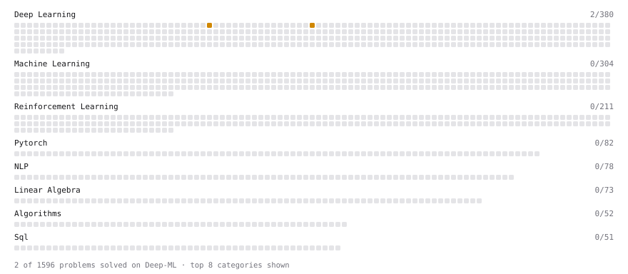

# Deep-ML

My machine learning practice from [Deep-ML](https://www.deep-ml.com). Every solution here was written by hand.

**2** solved · 2 problems · 0 labs · 0 math

[**Browse the interactive portfolio**](https://Marco6666662.github.io/deep-ml/) to replay this filling in over time.

## Problems

| | Difficulty | Solved | |
| --- | --- | --- | --- |
| [Dropout Layer](https://www.deep-ml.com/problems/151) | medium | 2026-10-16 | [solution](problems/0151-dropout-layer) |
| [Implement Batch Normalization for BCHW Input](https://www.deep-ml.com/problems/115) | medium | 2026-10-17 | [solution](problems/0115-implement-batch-normalization-for-bchw-input) |

---

_This file is regenerated by Deep-ML on every push._
